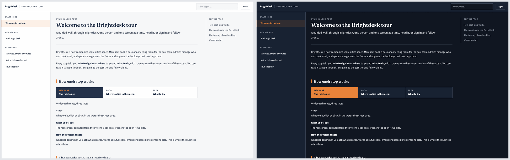

# userguide

A skill for Claude Code (and other coding agents that read `SKILL.md` skills)
that builds a **stakeholder tour** of any project: a branded, multi-page HTML
user guide with real screenshots captured from the running app.

Point it at a codebase, type `/userguide`, and it:

1. Maps every role, screen and business rule from the code, quoting the exact labels and messages.
2. Runs the app locally, with stand-ins for payment, courier or SMS services it can't reach.
3. Creates believable sample data through the real screens and captures every step with Playwright.
4. Writes and builds the guide, compresses the screenshots, and checks every page in a browser.
5. Hands you a zip, plus a private hosted page when your Claude session supports artifacts.



Every task in the guide is a "stop":
- **Route:** who to sign in as, where to go and what to try.
- **Steps:** click by click, in the words the screen uses.
- **What you'll see:** real screenshots; click one to enlarge it.
- **How the system reacts:** what it saves, blocks, emails or charges. This is where the business rules live.

Around the stops: a reference page of statuses, emails and time limits, an
honest "Not in this version yet" page, and a checklist that remembers your ticks.
Light and dark themes, works on phones, opens straight from the file system.

The look is fixed. Only the brand changes (two colours, fonts and logo, read from
your frontend), so every project's guide looks the same.

## Install

**Claude Code plugin** (recommended, easy to update):

```bash
claude plugin marketplace add omerbag-9/userguide-skill
claude plugin install userguide@omerbag-skills
```

Or inside a Claude Code session:

```text
/plugin marketplace add omerbag-9/userguide-skill
/plugin install userguide@omerbag-skills
```

Then run it with `/userguide:userguide`, or just ask for "a user guide for this project".

**Any agent** (Claude Code, Cursor, Codex and others), with the [skills CLI](https://github.com/vercel-labs/skills):

```bash
npx skills add omerbag-9/userguide-skill
```

**Plain install script**, as a personal skill in `~/.claude/skills/userguide`, run as `/userguide`:

```bash
curl -fsSL https://raw.githubusercontent.com/omerbag-9/userguide-skill/main/install.sh | bash
```

Add `-s -- --project` to install into the current repo's `.claude/skills/` instead,
or `-s -- --dir <path>` for another agent's skills folder.

## Requirements

On the machine where the agent runs:

- Python 3.9+
- Node 18+ with Playwright and Chromium:
  ```bash
  npm i -g playwright && npx playwright install chromium
  ```
- ImageMagick, for contact sheets and compression; `pngquant` is optional
- Whatever the project itself needs to run locally (database, cache, …)

## How it works

```
skills/userguide/
  SKILL.md              the workflow the agent follows
  assets/               fixed CSS and JS for every guide (menu, tabs, lightbox, theme, checklist)
  scripts/
    build.py            content file + screenshots -> site; fails on missing pages, shots or broken links
    guidekit.py         helpers the content file uses: page(), stop(), table(), note(), roles(), …
    capture.mjs         Playwright helpers for capture scripts
    verify.mjs          opens every page: console errors, broken images, phone overflow, wiring
    contact_sheet.sh    tiles screenshots for review
    compress.sh         shrinks screenshots about 60%
    prepare_artifact.py packages the guide as a Claude artifact
  reference/
    writing.md          page plan, writing rules, helper cheat sheet
    local-stack.md      running the app, mocking third parties, capture tips
    example_content.py  a worked example for a fictional app
```

The agent writes a single `guide_content.py` per project: product name, brand,
navigation and pages. `build.py` does the rest. You can edit that file and rebuild
by hand:

```bash
python3 -I skills/userguide/scripts/build.py --content guide_content.py --shots shots --out userguide
```

## Privacy

The guide is built in a scratch folder and is never committed to your repos
unless you ask. Screenshots show the sample data the agent creates, not
production data. Review the guide before sharing it outside your team.

## License

MIT
